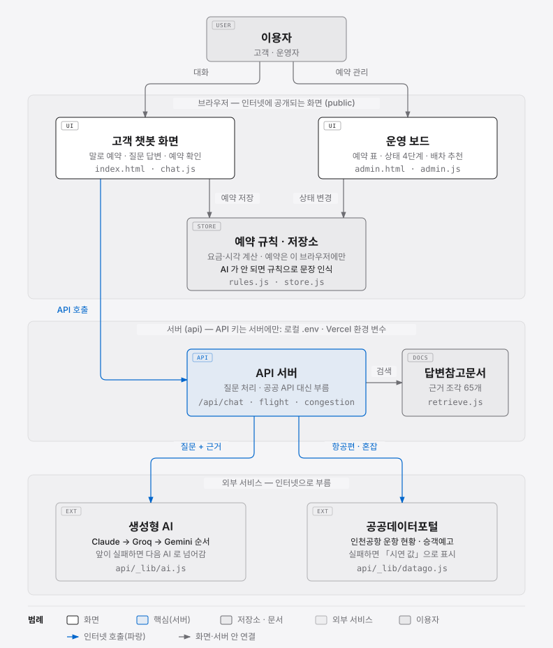

# 홈드랍 예약·안내 챗봇 (데모)

집에서 캐리어를 수거해 인천국제공항까지 옮겨 주는 「홈드랍」 서비스를, 고객은 **대화로 예약**하고 운영자는 **예약 표·배차 보드**로 관리하는 웹 데모입니다.

> ⚠️ 요금·수거 시각·배차 규칙은 **시연용 데모 값**입니다. 실제 이름·전화번호·주소를 입력하지 마세요.

## 시스템 설계도

요청은 위에서 아래로 — 브라우저 화면 → 서버 → 외부 서비스(AI · 공공데이터) 순서로 내려갑니다.



설명 카드까지 들어간 A4 한 장 판: [docs/시스템설계도.pdf](docs/시스템설계도.pdf)

## 화면과 기능

| 화면 | 주소 | 하는 일 |
|---|---|---|
| 고객 챗봇 | `/` | 「짐 맡기고 싶어요」로 시작해 7단계(고객 정보 → 항공편 → 짐 → 수거 시각 → 요금·금지 물품 → 예약 완료)로 예약, 태그 번호 발급, 요금·금지 물품 등 질문 답변, 태그 번호로 예약 확인 |
| 운영 보드 | `/admin.html` | 예약 표, 상태 4단계(접수 → 배차 완료 → 수거 완료 → 공항 인도), 같은 날 × 2시간 × 생활권역으로 묶는 배차 추천(차량당 캐리어 12개) |

- **AI 3단 대비**: Claude → Groq → Gemini 순서로 부르고, 앞이 실패하면(키 없음·오류·시간 초과) 다음으로 넘어갑니다. 모두 실패하거나 「규칙 모드」를 고르면 AI 없이 같은 예약 흐름을 규칙으로 진행합니다. 답마다 어느 AI 가 답했는지 표시합니다.
- **문서 근거 답변**: `docs/답변참고문서` 의 내용으로만 답하고 근거 문서 이름을 붙입니다. 문서에 없으면 모른다고 하고 문의처를 안내합니다.
- **공공데이터**: 인천국제공항공사 「여객편 주간 운항 현황」(항공편 확인)과 「승객예고-출·입국장별」(출국장 혼잡 안내). 쓰지 못하면 「시연 값」으로 표시합니다.
- **데모 규칙**: 기본 20,000원 + 1개 추가마다 10,000원 + 28인치 이상 대형 1개당 5,000원, 한 번에 8개까지, 수거는 출발 8시간 전까지, 수거 30분 전 기사 연락.

## 폴더

| 폴더·파일 | 내용 |
|---|---|
| `public/` | 화면 (챗봇 `index.html`, 운영 보드 `admin.html`, 규칙 `js/rules.js`, 예약 저장 `js/store.js`) |
| `api/` | 서버 (`chat.js` AI 답변·항목 인식, `flight.js` 운항 현황, `congestion.js` 승객예고) |
| `docs/답변참고문서/` | AI 답변 근거 문서 (`청킹/` 조각 65개를 서버가 읽음) |
| `server.js` · `vercel.json` | 로컬 실행 · Vercel 배포 설정 |

## 실행하기

```bash
npm install
npm start
```

`http://localhost:3000` (운영 보드는 `/admin.html`) 에서 열립니다. 실행 전에 프로젝트 맨 위에 `.env` 를 만들고 아래 이름으로 키를 넣습니다. **키는 `.env` 에만 적고 깃허브에 올리지 않습니다.**

| 이름 | 값 |
|---|---|
| `CLAUDE_API_KEY` | Claude API 키 |
| `GROQ_API_KEY` | Groq API 키 |
| `GEMINI_API_KEY` | Gemini API 키 |
| `INCHEON` | 공공데이터포털 서비스 키 (Encoding · Decoding 모두 됨) — 실패하면 `Passenger` 로 다시 시도 |

배포는 Vercel 에서 하고, 키는 Vercel 의 Environment Variables 에 같은 이름으로 넣습니다. 자세한 순서는 [docs/배포가이드.md](docs/배포가이드.md) 를 봅니다.

## 알아 둘 점

- 예약은 서버가 아니라 **이용자 브라우저(localStorage)** 에만 저장됩니다. 운영 보드는 같은 브라우저에서 열어야 예약이 보입니다.
- 항공편 정보는 오늘부터 6일 뒤까지, 출국장 혼잡 예상은 오늘·내일 것만 제공됩니다.
- 실제 도입 때는 개인정보 보호를 위해 기관 내부 AI 사용을 권고합니다.
- 이용약관(`/terms.html`) · 개인정보처리방침(`/privacy.html`)과 챗봇 동의 카드가 있습니다. 실제 서비스 전에 채울 빈칸과 남은 일은 [docs/실서비스준비.md](docs/실서비스준비.md) 를 봅니다.
